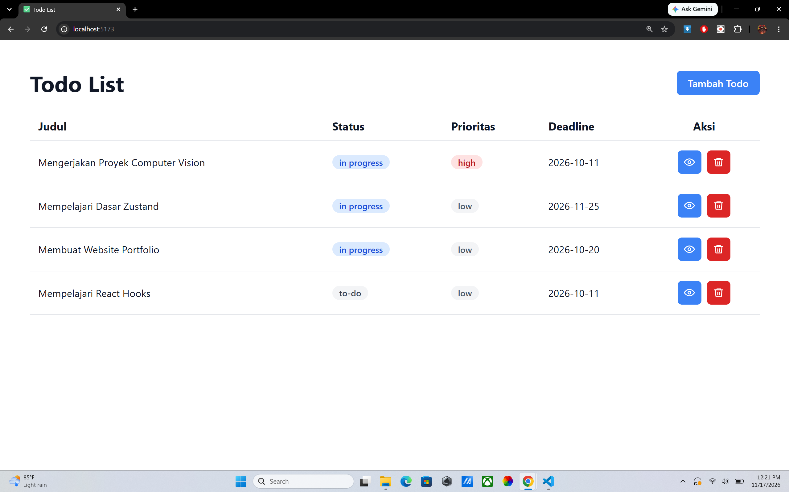

## Tampilan Aplikasi

### 1. Halaman Daftar Tugas
Menampilkan seluruh tugas dalam bentuk tabel (Judul, Status, Prioritas, Deadline, Aksi).

### 2. Menambah Tugas
Klik tombol **Tambah Todo**, lalu isi formulir.

Setelah disimpan, tugas baru langsung muncul di tabel disertai notifikasi.

### 3. Melihat Detail Tugas
Klik tombol biru (ikon mata) untuk membuka halaman detail (`/todo/:id`).

### 4. Memperbarui Tugas
Klik tombol **Update**, formulir sudah terisi data tugas yang dipilih.

Setelah disimpan, data pada halaman detail langsung berubah.

### 5. Menghapus Tugas
Klik tombol merah (ikon tempat sampah), akan muncul dialog konfirmasi sebelum tugas dihapus.

Setelah dikonfirmasi, tugas hilang dari tabel disertai notifikasi.

### 6. Validasi Formulir
Judul dan Deadline wajib diisi, jika kosong akan muncul pesan kesalahan.

### 7. Tampilan Responsif (Ponsel)
Pada layar kecil, tabel berubah menjadi kartu per tugas.

